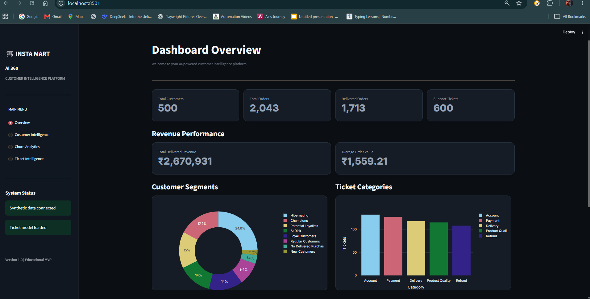
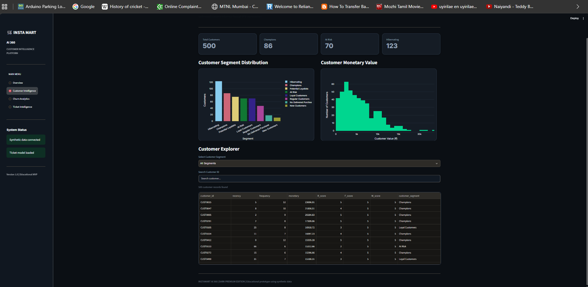
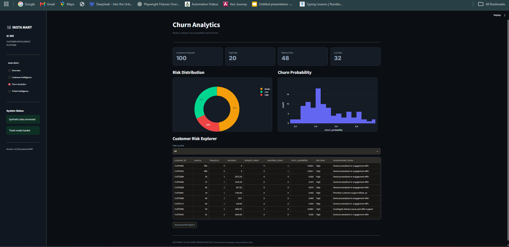
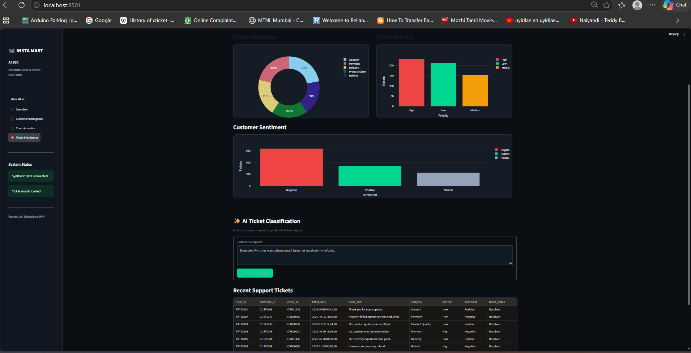

# 🛒 Instamart AI 360
### AI-Powered Customer Intelligence & Autonomous Support Platform

Instamart AI 360 is an end-to-end data science and machine learning project that demonstrates how a quick-commerce platform can use customer analytics, churn prediction, and automated support ticket classification to improve customer experience.

> **Note:** This is an educational prototype built using synthetic data. It is not an official Instamart or Swiggy product.

---

## 🚀 Project Overview

The project combines data analytics, machine learning, and an interactive Streamlit dashboard into one customer intelligence platform.

### Key Features

- **Customer Intelligence:** RFM analysis and customer segmentation.
- **Churn Prediction:** Predicts customer churn risk using a Random Forest model.
- **Ticket Intelligence:** Automatically classifies support tickets using TF-IDF and Logistic Regression.
- **Interactive Dashboard:** Modern dark-themed dashboard built with Streamlit and Plotly.
- **Synthetic Data:** Generates realistic sample datasets for analysis and model development.

---

## 🛠️ Technology Stack

| Category | Technologies |
|---|---|
| Programming | Python |
| Data Analysis | Pandas, NumPy |
| Visualization | Matplotlib, Seaborn, Plotly |
| Machine Learning | Scikit-learn |
| Dashboard | Streamlit |
| Model Storage | Joblib |
| Development | Jupyter Notebook, VS Code |
| Version Control | Git, GitHub |

---

## 📸 Dashboard Screenshots

### 1. Overview Dashboard



### 2. Customer Intelligence



### 3. Churn Analytics



### 4. Ticket Intelligence



---

## 📂 Project Structure

```text
instamart-ai-360/
│
├── dashboard/
│   └── app.py
│
├── data/
│   ├── raw/
│   ├── processed/
│   └── synthetic/
│       ├── customers.csv
│       ├── products.csv
│       ├── orders.csv
│       ├── order_items.csv
│       └── support_tickets.csv
│
├── models/
│   └── ticket_classifier.pkl
│
├── notebooks/
│   ├── 01_data_exploration.ipynb
│   ├── 02_customer_intelligence.ipynb
│   ├── 03_churn_prediction.ipynb
│   └── 04_ticket_intelligence.ipynb
│
├── screenshots/
│   ├── overview.png
│   ├── customer-intelligence.png
│   ├── churn-analytics.png
│   └── ticket-intelligence.png
│
├── src/
│   ├── generate_data.py
│   ├── main.py
│   └── validate_data.py
│
├── requirements.txt
├── .gitignore
└── README.md
```

---

## ⚙️ Installation and Setup

### 1. Clone the repository

```bash
git clone https://github.com/yuvansankarM/instamart-ai-360.git
cd instamart-ai-360
```

### 2. Create a virtual environment

```bash
python -m venv venv
```

### 3. Activate the virtual environment

**Windows PowerShell:**

```powershell
.\venv\Scripts\Activate.ps1
```

### 4. Install dependencies

```bash
pip install -r requirements.txt
```

### 5. Run the Streamlit dashboard

```bash
python -m streamlit run dashboard/app.py
```

The dashboard will open in your browser.

---

## 🧠 Machine Learning Modules

### 1. Customer Segmentation — RFM Analysis

RFM stands for:

- Recency: How recently a customer purchased.
- Frequency: How frequently a customer purchased.
- Monetary: How much a customer spent.

Customer segments include:

- Champions
- Loyal Customers
- Potential Loyalists
- At Risk
- Hibernating
- Regular Customers
- New Customers
- No Delivered Purchase

### 2. Customer Churn Prediction

**Algorithm:** Random Forest Classifier

The model uses historical customer activity and order-related features to estimate churn risk.

Features include:

- Total orders
- Delayed orders
- Cancelled orders
- Purchase frequency
- Monetary value
- Recency
- Average delivery time

Churn is defined using a synthetic 30-day inactivity rule.

### 3. Support Ticket Classification

**Algorithm:** TF-IDF + Logistic Regression

Ticket categories:

- Account
- Payment
- Delivery
- Product Quality
- Refund

The trained classifier is saved as:

```text
models/ticket_classifier.pkl
```

---

## 📊 Model Evaluation

The ticket classification experiment reported 100% accuracy on its synthetic test split.

**Important limitation:** This result may reflect patterns deliberately built into the synthetic ticket text. It does not establish real-world accuracy.

The churn model is an experimental baseline and requires further validation on realistic, independent data.

---

## 🔍 Data Validation

The synthetic datasets were validated for:

- Unique primary keys
- Valid foreign key relationships
- Dataset structure
- Basic data consistency

Dataset generation and validation scripts are available in `src/`.

---

## 🔐 Security and Data Privacy

- Uses synthetic customer data.
- Does not contain real customer records.
- Environment files and local virtual environments are excluded through `.gitignore`.
- No passwords, API keys, or private credentials should be committed.

---

## 🚧 Future Improvements

- Improve model evaluation using cross-validation.
- Add automated unit tests.
- Improve churn model validation.
- Add model performance monitoring.
- Implement explainable AI features.
- Deploy the dashboard to a cloud platform.
- Add more advanced customer analytics.

---

## 👨‍💻 Author

**Yuvansankar M.**

GitHub: [@yuvansankarM](https://github.com/yuvansankarM)

---

## ⭐ Acknowledgement

This project was developed as an educational portfolio project to demonstrate practical skills in Python, data analytics, machine learning, and dashboard development.